# open-python

A paper-driven Python laboratory for learning and researching machine learning. Every notebook states its problem, cites the paper behind the algorithm, runs from a clean kernel, and writes its numbers to a results file that the preview app reads.

[](https://github.com/robotjaol/open-python/actions/workflows/python-tests.yml)
[](https://github.com/robotjaol/open-python/actions/workflows/notebook-validation.yml)


**Preview app:** after you enable GitHub Pages (Settings, Pages, Source: GitHub Actions) the `preview-app` workflow publishes it at `https://robotjaol.github.io/open-python/`. It lists every notebook with saved metrics, figures, and the executed notebook. To build it locally: `make app`, then serve `app/dist`.

## Contents

- [What is inside](#what-is-inside)
- [Quick start](#quick-start)
- [Algorithm gallery](#algorithm-gallery)
  - [Supervised: regression](#supervised-regression)
  - [Supervised: classification](#supervised-classification)
  - [Unsupervised learning](#unsupervised-learning)
  - [Reinforcement learning](#reinforcement-learning)
  - [Advanced topics and end-to-end projects](#advanced-topics-and-end-to-end-projects)
- [How the notebooks are built](#how-the-notebooks-are-built)
- [Examples of saved results](#examples-of-saved-results)
- [Honest status](#honest-status)
- [Datasets](#datasets)
- [Contributing, security, citation](#contributing-security-citation)

## What is inside

| Folder | Content | Notebooks |
|---|---|---|
| `00_fundamentals` | Python, NumPy and pandas, plotting, linear algebra, probability, optimisation, ML concepts, feature engineering | 8 |
| `01_supervised_learning` | 8 regression and 12 classification algorithms on real datasets | 20 |
| `02_unsupervised_learning` | Clustering, dimensionality reduction, anomaly detection | 10 |
| `03_reinforcement_learning` | Dynamic programming, Monte Carlo, TD, SARSA, Q-learning, DQN, Double DQN, REINFORCE, actor-critic, PPO | 10 |
| `04_advanced_machine_learning` | Imbalance, calibration, leakage-free feature selection, explainability, nested tuning, robustness | 6 |
| `05_end_to_end_projects` | Ten projects with 13 parts each, from problem statement to recommendation | 10 |
| `06_model_deployment` | Model card with checksum, FastAPI service, batch scoring, drift check | scripts |
| `src/ml_lab` | Shared library: data, preprocessing, evaluation, RL, deployment | |
| `research`, `datasets`, `docs` | Source register, comparisons, dataset catalog, 13 documentation pages | |

## Quick start

```bash
git clone https://github.com/robotjaol/open-python.git && cd open-python
python -m venv .venv && source .venv/bin/activate
pip install -e ".[all,development]"
make test
jupyter lab 00_fundamentals/01_python_for_ml/01_python_for_ml.ipynb
```

Details: [docs/getting-started.md](docs/getting-started.md). Study order: [docs/learning-roadmap.md](docs/learning-roadmap.md).

## Algorithm gallery

Each preview is a figure saved by the algorithm's own notebook in [`experiments/figures`](experiments/figures). The line under each name is read from [`experiments/results`](experiments/results). Click a name to open its folder with the notebook, README and references. All numbers are single runs on held-out test rows (seed 42), so treat them as illustrations and read each notebook's limitations before comparing algorithms. Datasets differ between algorithms, so scores are not comparable across them.

### Supervised: regression

Preview: predicted against actual values on test rows. Points on the dashed diagonal are perfect predictions.

<table>
<tr><td align="center" valign="top">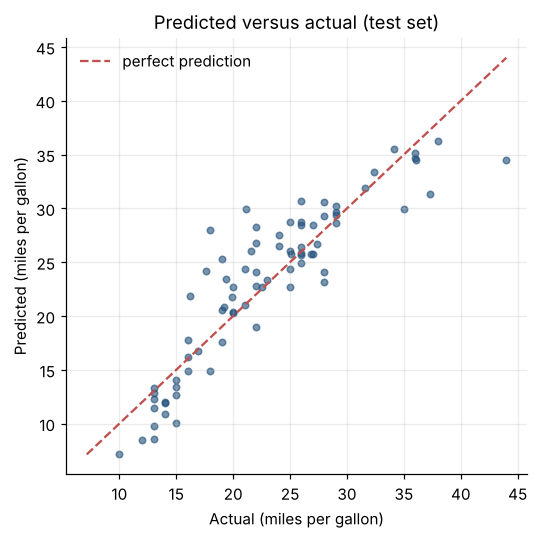<br><a href="01_supervised_learning/01_regression/linear_regression"><b>Linear Regression</b></a><br><sub>Auto MPG · R² 0.790 · RMSE 3.27</sub></td><td align="center" valign="top">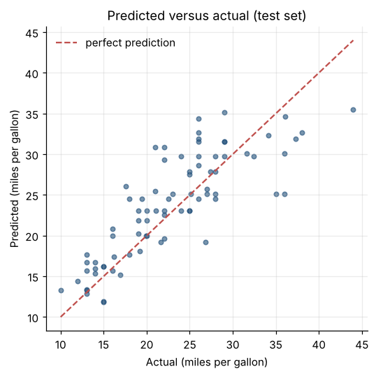<br><a href="01_supervised_learning/01_regression/polynomial_regression"><b>Polynomial Regression</b></a><br><sub>Auto MPG · R² 0.657 · RMSE 4.19</sub></td><td align="center" valign="top"><br><a href="01_supervised_learning/01_regression/ridge_regression"><b>Ridge Regression</b></a><br><sub>Diabetes · R² 0.454 · RMSE 53.78</sub></td><td align="center" valign="top">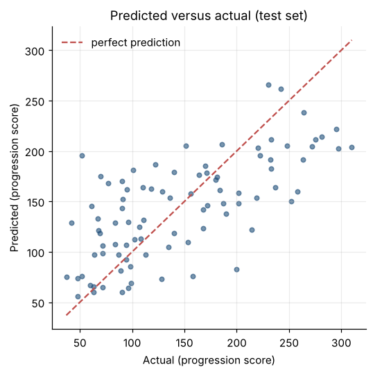<br><a href="01_supervised_learning/01_regression/lasso_regression"><b>Lasso Regression</b></a><br><sub>Diabetes · R² 0.471 · RMSE 52.94</sub></td></tr>
<tr><td align="center" valign="top">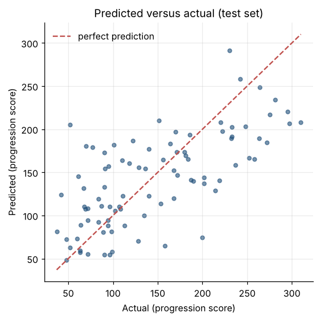<br><a href="01_supervised_learning/01_regression/elastic_net"><b>Elastic Net</b></a><br><sub>Diabetes · R² 0.456 · RMSE 53.71</sub></td><td align="center" valign="top">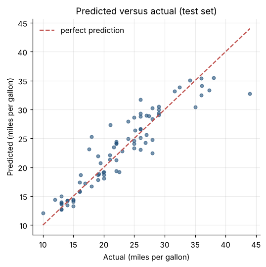<br><a href="01_supervised_learning/01_regression/support_vector_regression"><b>Support Vector Regression</b></a><br><sub>Auto MPG · R² 0.860 · RMSE 2.67</sub></td><td align="center" valign="top">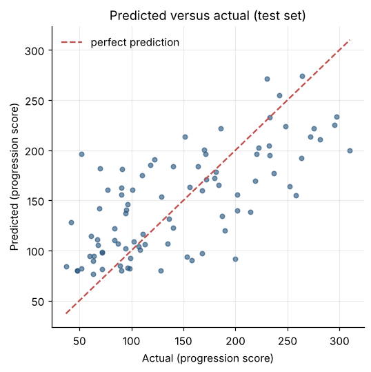<br><a href="01_supervised_learning/01_regression/gradient_boosting_regressor"><b>Gradient Boosting Regressor</b></a><br><sub>Diabetes · R² 0.494 · RMSE 51.76</sub></td><td align="center" valign="top">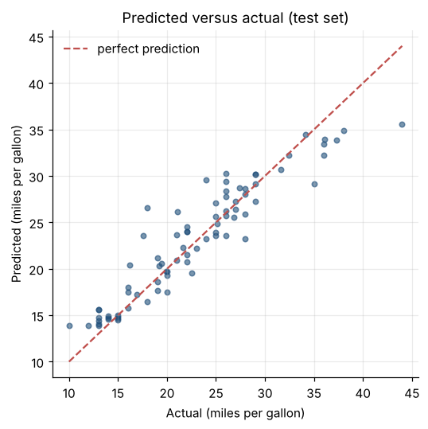<br><a href="01_supervised_learning/01_regression/hist_gradient_boosting"><b>Histogram Gradient Boosting</b></a><br><sub>Auto MPG · R² 0.869 · RMSE 2.58</sub></td></tr>
</table>

### Supervised: classification

Preview: row-normalised confusion matrix on test rows. Each notebook also saves ROC and precision-recall curves, learning curves and decision regions where they apply. AUC is ROC-AUC, one-vs-rest for multi-class data.

<table>
<tr><td align="center" valign="top"><br><a href="01_supervised_learning/02_classification/logistic_regression"><b>Logistic Regression</b></a><br><sub>Breast cancer · Acc 0.982 · AUC 0.998</sub></td><td align="center" valign="top">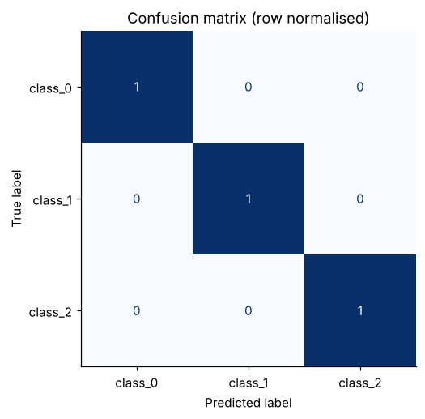<br><a href="01_supervised_learning/02_classification/k_nearest_neighbors"><b>k-Nearest Neighbors</b></a><br><sub>Wine · Acc 1.000 · AUC 1.000</sub></td><td align="center" valign="top">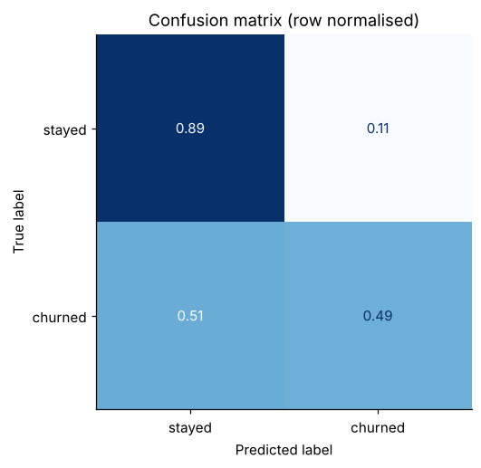<br><a href="01_supervised_learning/02_classification/decision_tree"><b>Decision Tree</b></a><br><sub>Telco churn · Acc 0.787 · AUC 0.816</sub></td><td align="center" valign="top"><br><a href="01_supervised_learning/02_classification/random_forest"><b>Random Forest</b></a><br><sub>Telco churn · Acc 0.798 · AUC 0.833</sub></td></tr>
<tr><td align="center" valign="top">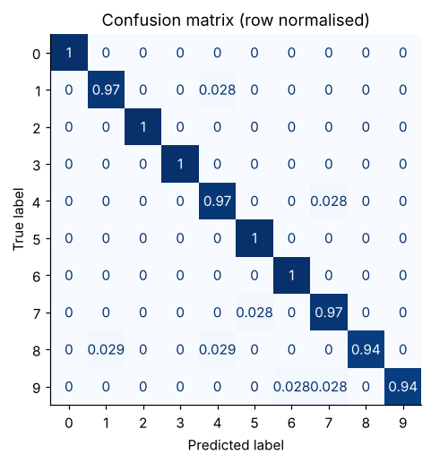<br><a href="01_supervised_learning/02_classification/support_vector_machine"><b>Support Vector Machine</b></a><br><sub>Digits · Acc 0.981 · AUC 1.000</sub></td><td align="center" valign="top">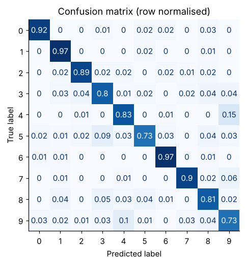<br><a href="01_supervised_learning/02_classification/naive_bayes"><b>Naive Bayes</b></a><br><sub>MNIST subset · Acc 0.855 · AUC 0.980</sub></td><td align="center" valign="top"><br><a href="01_supervised_learning/02_classification/xgboost"><b>XGBoost</b></a><br><sub>Telco churn · Acc 0.806 · AUC 0.848</sub></td><td align="center" valign="top"><br><a href="01_supervised_learning/02_classification/lightgbm"><b>LightGBM</b></a><br><sub>Telco churn · Acc 0.805 · AUC 0.847</sub></td></tr>
<tr><td align="center" valign="top">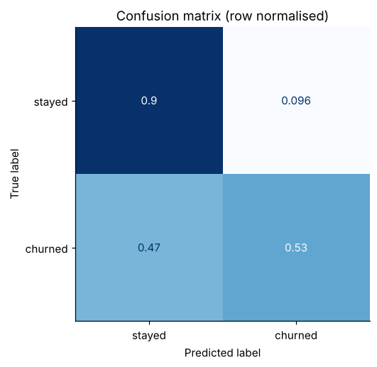<br><a href="01_supervised_learning/02_classification/catboost"><b>CatBoost</b></a><br><sub>Telco churn · Acc 0.804 · AUC 0.845</sub></td><td align="center" valign="top">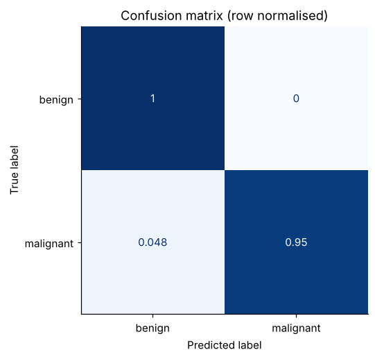<br><a href="01_supervised_learning/02_classification/adaboost"><b>AdaBoost</b></a><br><sub>Breast cancer · Acc 0.982 · AUC 0.984</sub></td><td align="center" valign="top">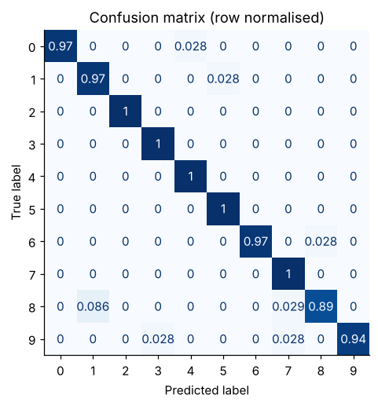<br><a href="01_supervised_learning/02_classification/extra_trees"><b>Extra Trees</b></a><br><sub>Digits · Acc 0.975 · AUC 1.000</sub></td><td align="center" valign="top">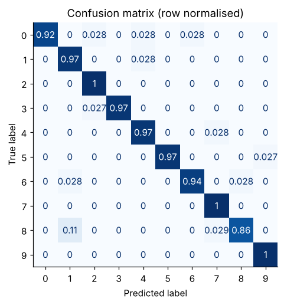<br><a href="01_supervised_learning/02_classification/mlp"><b>MLP (neural network)</b></a><br><sub>Digits · Acc 0.961 · AUC 0.997</sub></td></tr>
</table>

### Unsupervised learning

Clustering previews show model selection curves or a dendrogram next to the clusters. Dimensionality reduction previews show explained variance or the 2D embedding. Clustering scores use labels only for evaluation, never for fitting.

**[K-Means](02_unsupervised_learning/01_clustering/kmeans)** — Wine · 3 clusters · Silhouette 0.285 · ARI 0.897

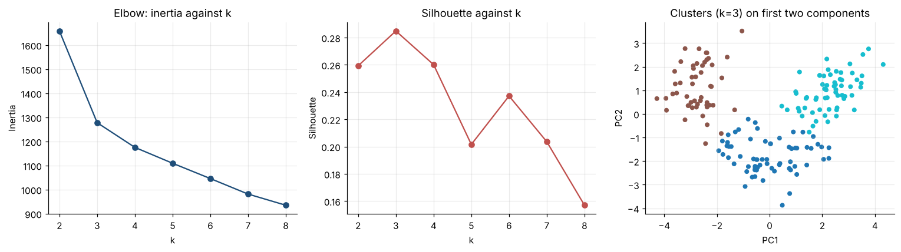

**[Hierarchical Clustering](02_unsupervised_learning/01_clustering/hierarchical_clustering)** — Wine · 3 clusters · Silhouette 0.277 · ARI 0.790

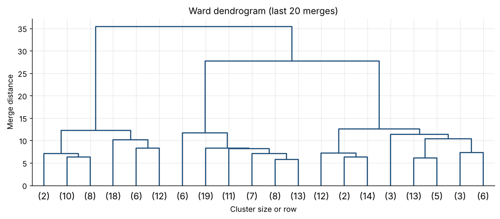

**[DBSCAN](02_unsupervised_learning/01_clustering/dbscan)** — Digits · 12 clusters · Silhouette 0.270 · ARI 0.806 on non-noise points · noise 25.9%

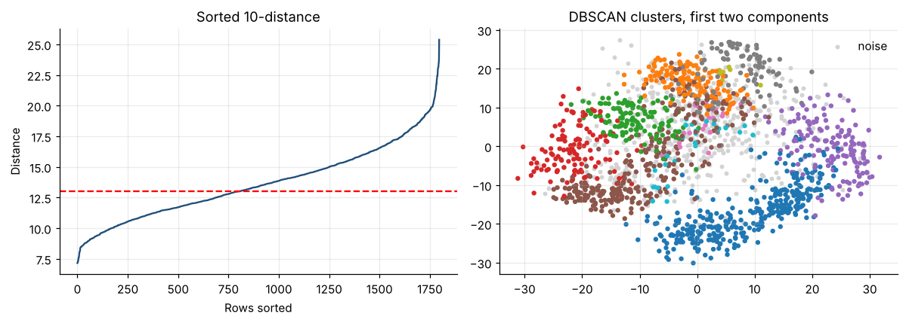

**[HDBSCAN](02_unsupervised_learning/01_clustering/hdbscan)** — Digits · 7 clusters · Silhouette 0.320 · ARI 0.653 on non-noise points · noise 44.4%

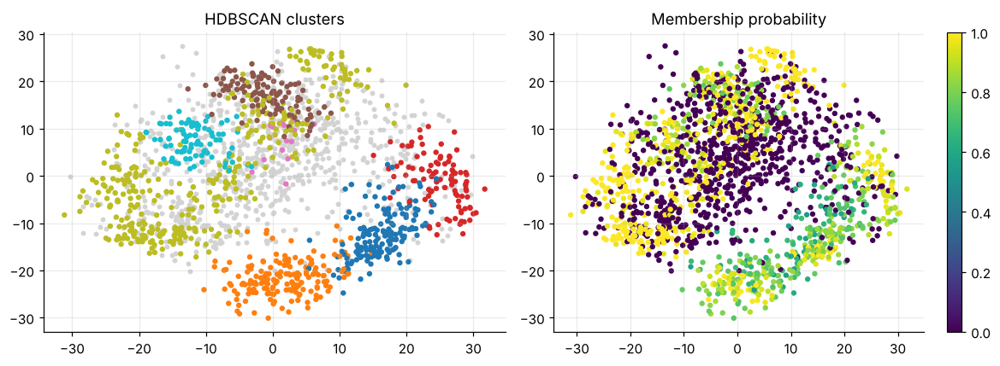

**[Gaussian Mixture](02_unsupervised_learning/01_clustering/gaussian_mixture)** — Auto MPG · 7 clusters · Silhouette 0.137 · ARI 0.067

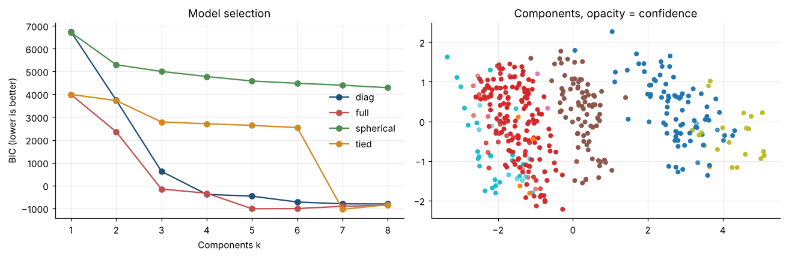

**[Spectral Clustering](02_unsupervised_learning/01_clustering/spectral_clustering)** — Digits · 15 clusters · Silhouette 0.212 · ARI 0.794

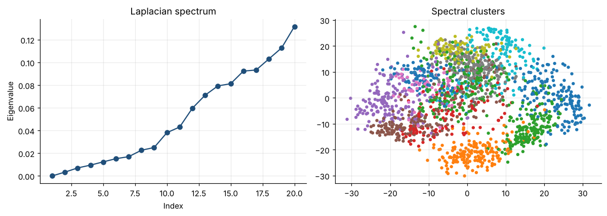

**[PCA](02_unsupervised_learning/02_dimensionality_reduction/pca)** — Breast cancer · 10 components keep 95.2% of variance

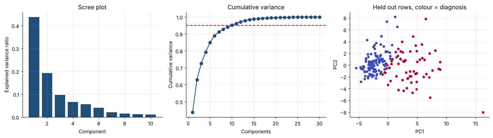

**[t-SNE](02_unsupervised_learning/02_dimensionality_reduction/tsne)** — Digits · trustworthiness 0.993 (PCA 2D: 0.832)

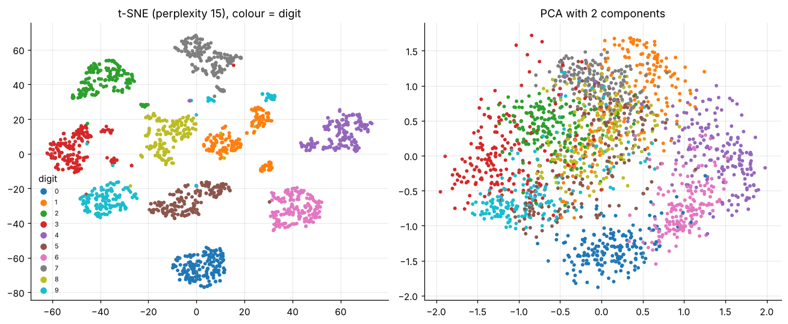

**[UMAP](02_unsupervised_learning/02_dimensionality_reduction/umap)** — Digits · held-out trustworthiness 0.980 (train 0.988)

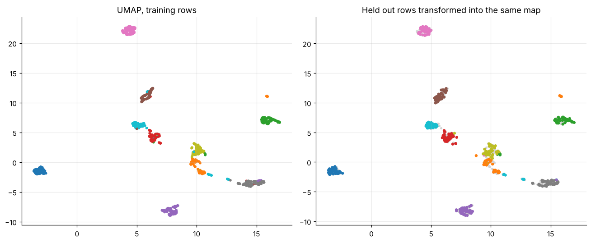

**[Isolation Forest](02_unsupervised_learning/03_anomaly_detection/isolation_forest)** — Breast cancer · ROC-AUC 0.983 · PR-AUC 0.764 (random PR-AUC 0.044)

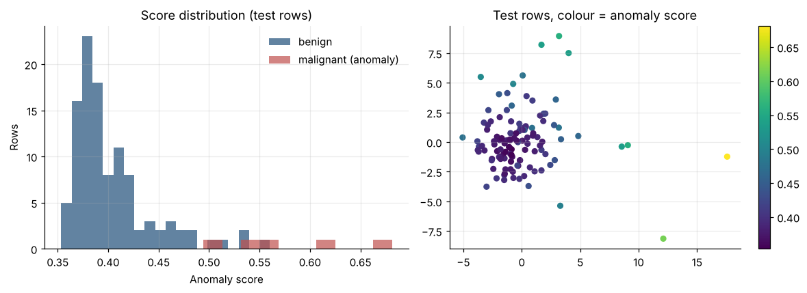

### Reinforcement learning

Learning curves use 3 training seeds. Deep RL uses a short CPU budget, so seed variance is large, for example DQN ranges from 73.7 to 500 across its three seeds. Double DQN scored below DQN in this setup, and the result is reported as saved.

**[Dynamic Programming](03_reinforcement_learning/01_tabular/dynamic_programming)** — FrozenLake-v1 4×4 · optimal policy succeeds 0.824 (exact), random policy 0.014

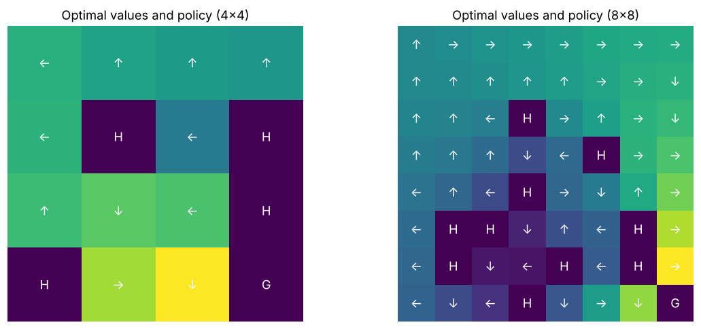

**[Monte Carlo Control](03_reinforcement_learning/01_tabular/monte_carlo)** — Blackjack-v1 · mean return −0.052 vs random −0.390

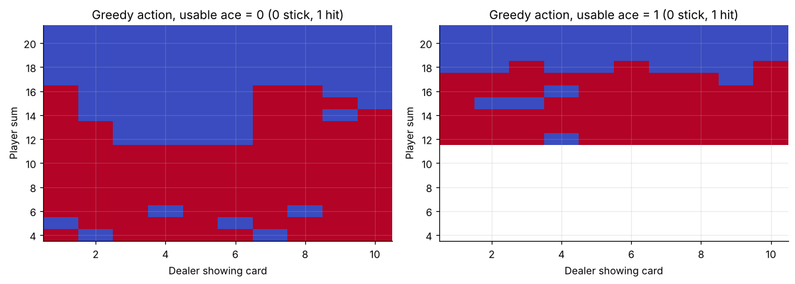

**[Temporal Difference, TD(0)](03_reinforcement_learning/01_tabular/temporal_difference)** — FrozenLake-v1 · value RMSE 0.028 vs Monte Carlo 0.293 (alpha 0.05)

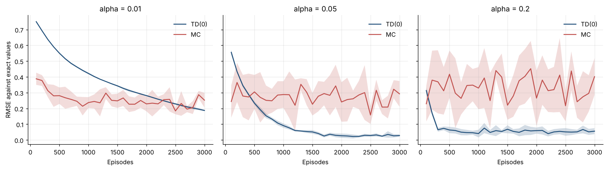

**[SARSA](03_reinforcement_learning/01_tabular/sarsa)** — CliffWalking-v1 · online return −26.2 vs Q-learning −47.5

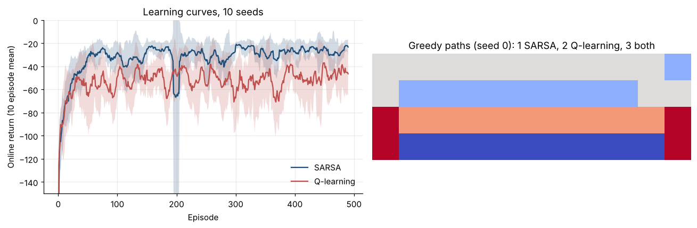

**[Q-learning](03_reinforcement_learning/01_tabular/q_learning)** — FrozenLake-v1 · success rate 0.75 vs random 0.018

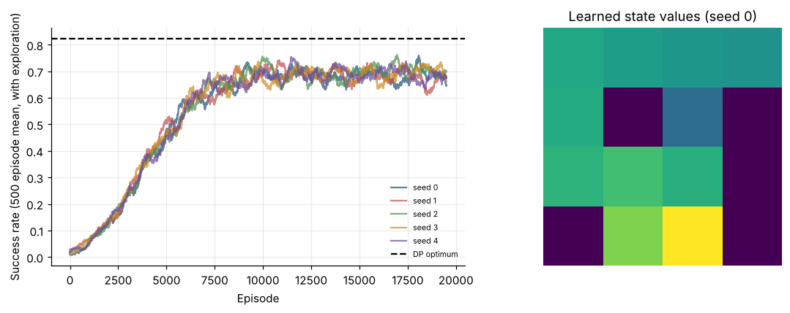

**[DQN](03_reinforcement_learning/02_deep_value_methods/dqn)** — CartPole-v1 · eval return 354.0 ± 242.8 across 3 seeds (max 500)

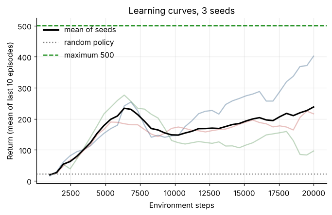

**[Double DQN](03_reinforcement_learning/02_deep_value_methods/double_dqn)** — CartPole-v1 · eval return 113.9 vs DQN 354.0, 3 seeds

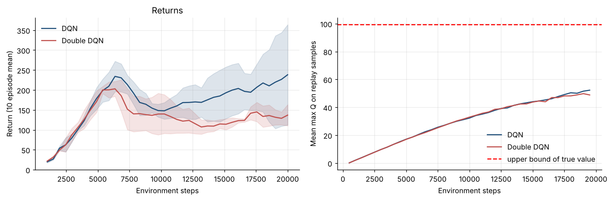

**[REINFORCE](03_reinforcement_learning/03_policy_gradient_methods/reinforce)** — CartPole-v1 · eval return 318.2 ± 157.7 across 3 seeds (max 500)

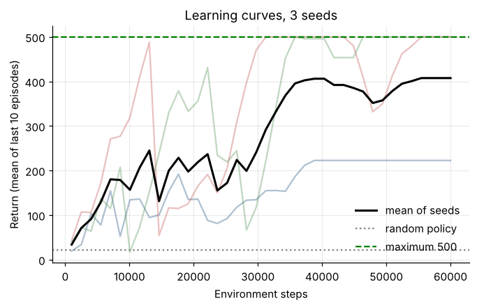

**[Actor-Critic](03_reinforcement_learning/03_policy_gradient_methods/actor_critic)** — CartPole-v1 · eval return 114.6 ± 182.2 across 3 seeds (max 500)

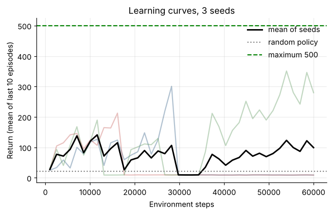

**[PPO](03_reinforcement_learning/03_policy_gradient_methods/ppo)** — CartPole-v1 · eval return 499.5 ± 0.9 across 3 seeds (max 500)

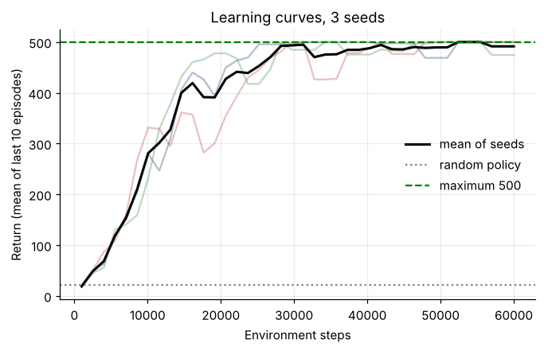

### Advanced topics and end-to-end projects

Advanced notebooks (`04_advanced_machine_learning`) with a saved figure:

<table>
<tr><td align="center" valign="top">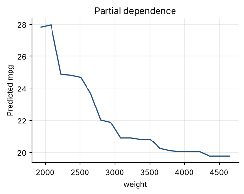<br><a href="04_advanced_machine_learning/explainable_ai"><b>Explainable AI</b></a><br><sub>Auto MPG · test R² 0.887</sub></td><td align="center" valign="top">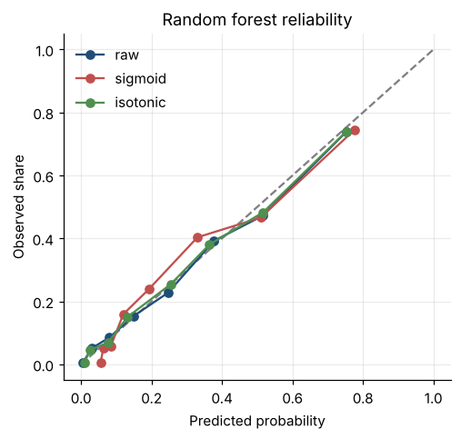<br><a href="04_advanced_machine_learning/model_calibration"><b>Model Calibration</b></a><br><sub>Telco churn · reliability diagram</sub></td><td align="center" valign="top">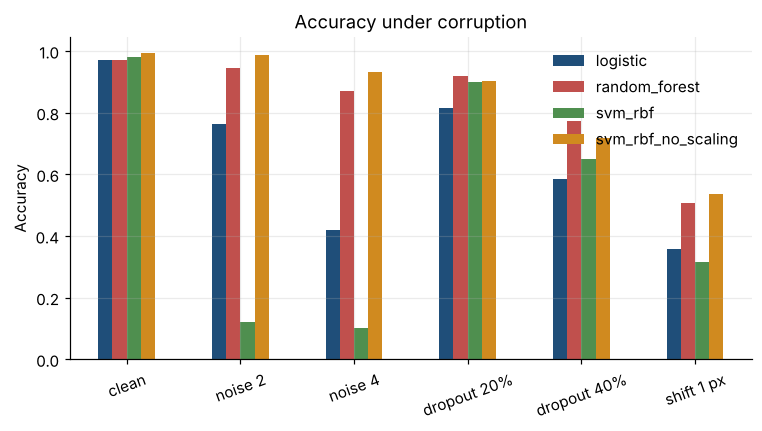<br><a href="04_advanced_machine_learning/model_robustness"><b>Model Robustness</b></a><br><sub>Digits · accuracy under noise, dropout and shift</sub></td></tr>
</table>

End-to-end projects (`05_end_to_end_projects`) with a saved figure:

<table>
<tr><td align="center" valign="top">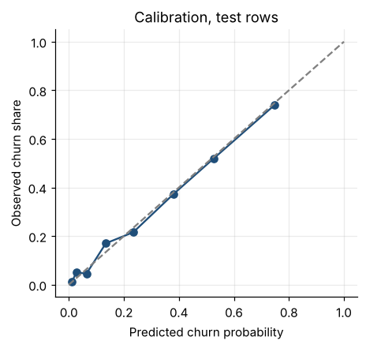<br><a href="05_end_to_end_projects/customer_churn"><b>Customer Churn</b></a><br><sub>Telco churn · test PR-AUC 0.661 vs baseline 0.265</sub></td><td align="center" valign="top">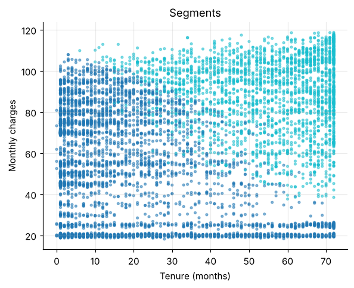<br><a href="05_end_to_end_projects/customer_segmentation"><b>Customer Segmentation</b></a><br><sub>Telco churn · 2 segments · Silhouette 0.459</sub></td><td align="center" valign="top">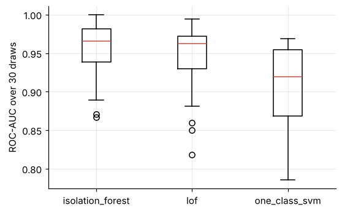<br><a href="05_end_to_end_projects/anomaly_screening"><b>Anomaly Screening</b></a><br><sub>Breast cancer · Isolation Forest ROC-AUC 0.957</sub></td></tr>
<tr><td align="center" valign="top">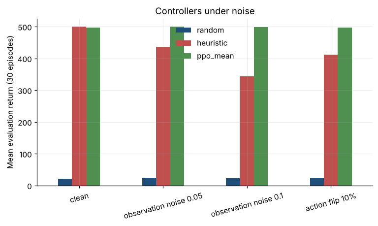<br><a href="05_end_to_end_projects/autonomous_control"><b>Autonomous Control</b></a><br><sub>CartPole-v1 · PPO 496.6 vs random 21.0</sub></td><td align="center" valign="top">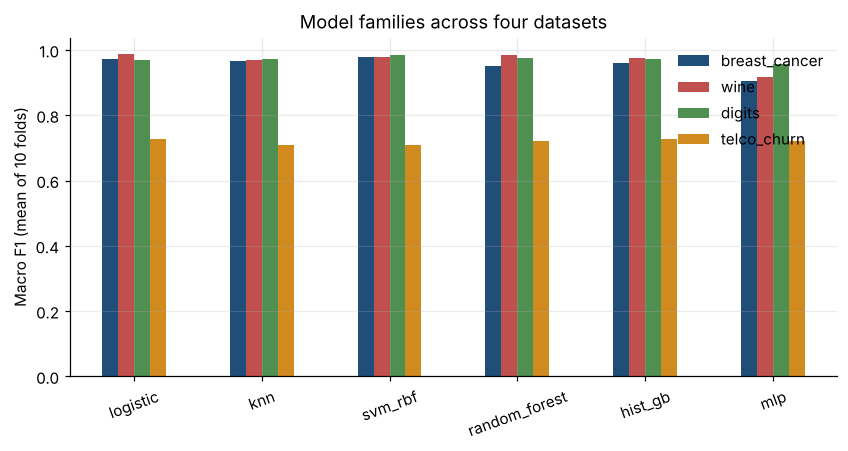<br><a href="05_end_to_end_projects/tabular_model_benchmark"><b>Tabular Model Benchmark</b></a><br><sub>Six model families, average rank</sub></td><td></td></tr>
</table>

Notebooks without a saved figure: feature selection, hyperparameter optimisation and imbalanced learning in `04_advanced_machine_learning`, and diabetes interpretation, digit recognition, fuel efficiency regression, medical classification and wine authentication in `05_end_to_end_projects`. Their numbers are in `experiments/results` and in the preview app. The eight `00_fundamentals` notebooks teach concepts and do not save per-algorithm figures.

To regenerate every figure and result, run `python tools/run_notebooks.py`.

## How the notebooks are built

1. Each supervised notebook follows a 15 section template (problem, why this algorithm, paper, mathematics, data, preprocessing, from-scratch version, library version, training, evaluation, visualisation, interpretation, experiments, exercises, limitations).
2. Splits are 60/20/20. Preprocessing is fitted on training rows only. One setting is chosen on validation rows, the model is refitted on training plus validation rows, and the test rows are scored once, next to a dummy baseline and 5-fold cross validation.
3. Reinforcement learning notebooks use evaluation seeds that training never saw, several training seeds, a random-policy floor, and exact dynamic programming references where they exist.
4. Notebooks are executed by `tools/run_notebooks.py` from a clean kernel. `tests/notebook_validation` checks that every notebook is valid, executed, error free, and free of local paths.

## Examples of saved results

Single runs, see the notebooks for limits.

| Project | Result | Baseline |
|---|---|---|
| Customer churn (Telco, 7043 rows) | PR-AUC 0.661 on test rows | 0.265 (predicting the churn share) |
| Breast tumour diagnosis (569 rows) | ROC-AUC 0.995. Sensitivity 0.857 at a threshold meant for 0.95, 95% interval 0.735 to 0.958 | |
| CartPole control, 3 seeds | PPO 496.6 mean return, hand written rule 500, random 21.0 | 500 is the maximum |
| Anomaly screening, 30 draws | Isolation Forest ROC-AUC 0.957 (std 0.037) | Random PR-AUC 0.048 |

The medical row is shown because it fails its own target on test rows. That is a useful result, not a hidden one.

## Honest status

Not everything in the original plan exists. The full table is in the preview app and in [CHANGELOG.md](CHANGELOG.md).

- **Blocked:** projects on predictive maintenance, credit risk, fraud detection, energy forecasting and recommendation. Their usual open datasets were on hosts the build environment could not reach. Nothing was simulated in their place. See [05_end_to_end_projects/BLOCKED.md](05_end_to_end_projects/BLOCKED.md).
- **Not implemented:** A2C, SAC, DDPG, TD3, offline RL, time series notebooks, Docker deployment.
- **Not validated:** the GitHub Actions workflows were written and parsed but have not run on GitHub yet.
- **Partly verified:** most references were checked against Crossref or arXiv. Four are marked "not verified" in [research/source-register.md](research/source-register.md).
- **Lock file:** `uv.lock` was resolved with `uv lock` (230 packages) but nothing was installed from it and CI does not use it yet.
- **Small scale:** deep RL uses 3 seeds and a short CPU budget. Datasets are small. Read each notebook's limitations.

## Datasets

Bundled datasets come from installed packages. Telco churn is downloaded and checked with SHA-256. Licences and limits are in [datasets/README.md](datasets/README.md). You are responsible for following each dataset's terms.

## Contributing, security, citation

[CONTRIBUTING.md](CONTRIBUTING.md), [SECURITY.md](SECURITY.md), [CODE_OF_CONDUCT.md](CODE_OF_CONDUCT.md). Cite with [CITATION.cff](CITATION.cff). Licensed under [MIT](LICENSE).
